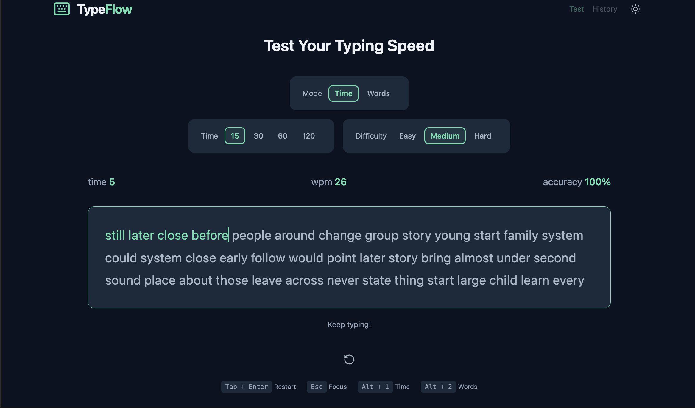
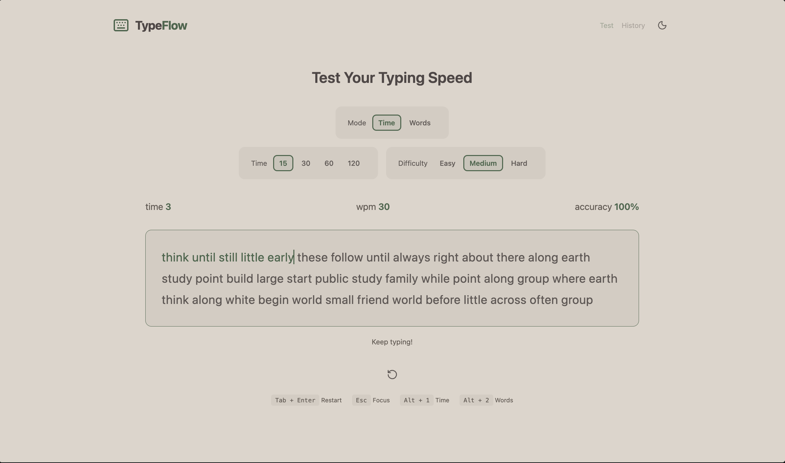
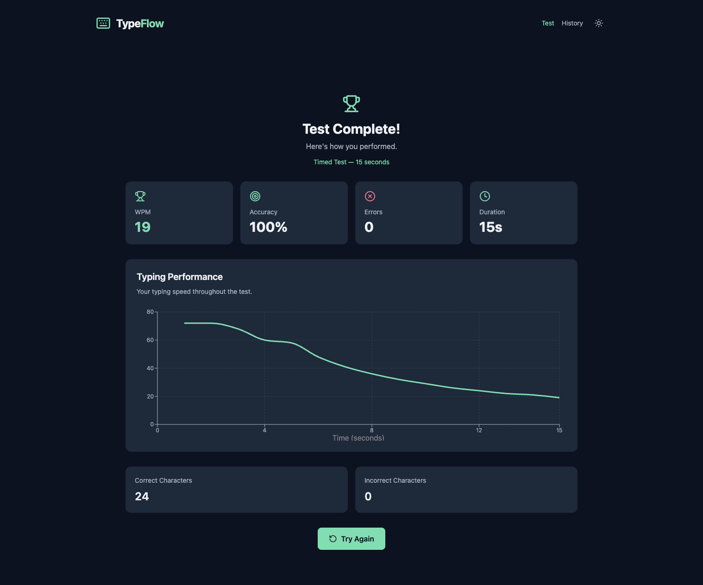
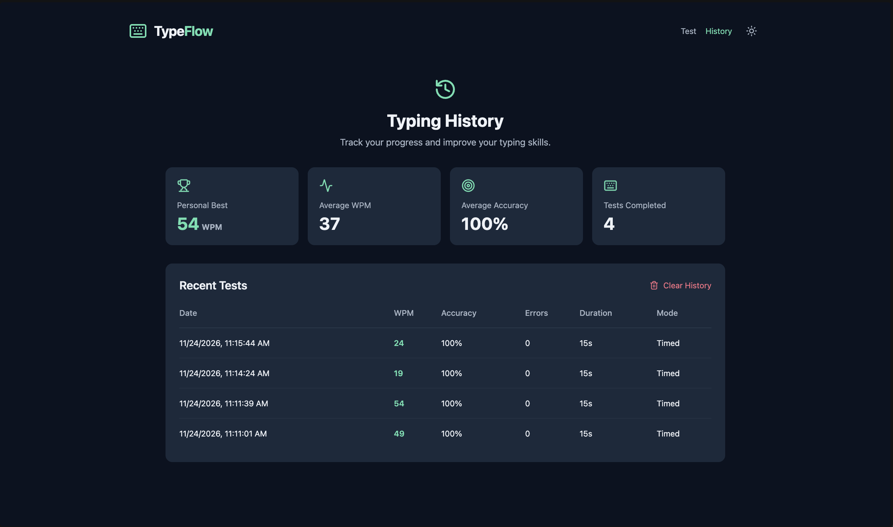

# TypeFlow

A modern, responsive typing speed test application built with
React, TypeScript, and Tailwind CSS. TypeFlow allows users to
measure their typing speed, improve accuracy, visualize performance,
and track their progress over time.

## Features

### Typing Tests

- Timed tests: 15, 30, 60, and 120 seconds
- Word-count tests: 10, 25, 50, and 100 words
- Three difficulty levels: Easy, Medium, and Hard
- Randomized word generation
- Real-time words per minute (WPM) and accuracy tracking
- Character level visual feedback
- Visible error indicators for incorrectly typed spaces
- Automatic text scrolling during typing
- Backspace support for correcting mistakes
- Input restrictions to prevent pasting, cutting, and dropping text

### Performance Analytics

- Final WPM and accuracy statistics
- Correct and incorrect character counts
- Test duration
- Interactive typing performance chart
- Performance measurements recorded throughout each test

### Typing History

- Automatically saved completed tests
- Personal best WPM
- Average typing speed and accuracy
- Total tests completed
- Recent and complete test history
- Clear history functionality

### User Experience

- Midnight Navy dark theme
- Old book Beige light theme
- Persistent user preferences
- Responsive layout for different screen sizes
- Accessible keyboard navigation
- Visible focus and selected-setting indicators
- Keyboard shortcuts for common actions

## Screenshots

### Dark Mode



### Light Mode



### Results Dashboard



### Typing History



## Technology Stack

| Technology   | Purpose                                 |
| ------------ | --------------------------------------- |
| React        | Component-based user interface          |
| TypeScript   | Static typing and type safety           |
| Vite         | Development server and production build |
| Tailwind CSS | Styling and responsive design           |
| Recharts     | Performance data visualization          |
| Lucide React | Interface icons                         |
| LocalStorage | Persistent history and preferences      |
| ESLint       | Code quality and linting                |
| Git & GitHub | Version control                         |

## Getting Started

### Prerequisites

- Node.js compatible with the project's Vite version
- npm

### Installation

1. Clone the repository.
2. Navigate to the TypeFlow project directory.
3. Install the dependencies.

```bash
npm install
```

### Run Locally

Start the development server:

```bash
npm run dev
```

Open the local URL displayed in the terminal.

### Production Build

```bash
npm run build
```

Preview the production build locally:

```bash
npm run preview
```

### Linting

```bash
npm run lint
```

## Keyboard Shortcuts

| Shortcut         | Action                              |
| ---------------- | ----------------------------------- |
| Tab + Enter      | Restart the current test            |
| Escape           | Return focus to the typing area     |
| Alt / Option + 1 | Switch to timed mode                |
| Alt / Option + 2 | Switch to word-count mode           |
| Backspace        | Correct previously typed characters |

## Scoring Methodology

### Words Per Minute (WPM)

Typing speed is calculated using the standard convention of
five characters per word.

WPM = (Correct Characters / 5) / Elapsed Minutes

Only correctly typed characters contribute to the WPM score.
Completed tests use the actual elapsed time for their final
WPM calculation.

### Accuracy

Accuracy = (Correct Characters / Typed Characters) × 100

Accuracy is calculated from the current input by comparing
typed characters with their expected positions. Corrected
mistakes are removed from the current error count.

### Performance Tracking

Typing performance is sampled throughout the test, recording
cumulative WPM and accuracy. A final performance measurement
is included to ensure that the chart reflects the completed
test result.

## Difficulty Levels

| Difficulty | Word Length           |
| ---------- | --------------------- |
| Easy       | 4 characters or fewer |
| Medium     | 5–6 characters        |
| Hard       | 7 characters or more  |

## Performance Optimization

TypeFlow uses React lazy loading and dynamic imports to
separate the results dashboard and its charting dependencies
from the initial application bundle.

During development, this reduced the initial JavaScript
bundle from approximately 644 KB to 247 KB, a reduction of
approximately 62%.

This allows users to load the typing interface without
immediately downloading the results dashboard.

Additional optimizations include:

- Production asset minification
- Automatic Vite code splitting
- Disabled performance chart animations
- Bounded typing text rendering through a scrolling viewport

## Privacy and Data Storage

TypeFlow does not require an account or a backend server.

Typing history and user preferences are stored locally in
the user's browser through LocalStorage.

Users can clear their typing history directly from the
application. Clearing browser storage also removes locally
saved application data.

## Quality Assurance

The application has been manually tested for:

- Timed and word-count test functionality
- Typing speed and accuracy calculations
- Input validation and error handling
- Keyboard controls
- Theme switching
- Persistent history and preferences
- Responsive layouts
- Production build behavior

The project also uses ESLint, TypeScript compilation,
and npm dependency auditing as part of its development workflow.
